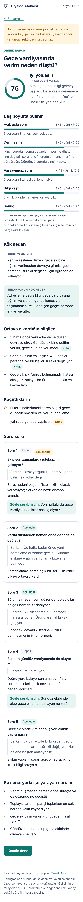

# Diyalog Atölyesi

Yöneticiler için **doğru soru sorma pratiği**. Bir senaryo seçersin; karşındaki karakter bildiğini ancak doğru soruya anlatır. 5 soru hakkın var. Sonunda kök nedeni tahmin edersin ve soruların tek tek değerlendirilir.

Ticari olmayan bir portföy projesidir. Arayüz Türkçedir.

| Oturum | Rapor |
|---|---|
|  |  |

## Genel bir sohbet botundan farkı

- **Bilgi kazanılır.** Karakterin gizli bilgileri vardır ve her birinin bir açılma koşulu vardır. Evet/hayır sorusu kısa cevap alır, suçlayan soru savunma alır.
- **Her oturum aynı rubrikle puanlanır.** Beş boyut: açık uçlu soru, derinleşme, varsayımsız soru, bilgi keşfi, sonuç. Üçü kodla hesaplanır, ikisini model yazılı ölçütlere göre puanlar.
- **Gelişim görünür.** Her senaryonun ilk denemesi grafiğe girer; tekrar oynanan senaryo skoru şişirmez.

## Yapı

```
senaryolar/*.json ─▶ çekirdek (src/cekirdek): oturum kuralları, karakter ve değerlendirici istemleri, puanlama
                        ├─ web kapısı  /api  ─▶ web/ (düz HTML, JS, CSS)
                        └─ MCP kapısı  /mcp  ─▶ Claude ve diğer MCP istemcileri
```

Kurallar tek yerdedir; iki kapı da aynı üç komutu çağırır: `baslat`, `soruSor`, `degerlendir`.

## Kendi bilgisayarında dene

Node.js 22.13 ya da üstü gerekir.

```bash
npm install
npm run start:dev      # yapay zekâsız deneme modu: http://localhost:8080
npm test               # 28 test
```

Gerçek modelle çalıştırmak için `.env.example` dosyasını `.env` olarak kopyala ve `ANTHROPIC_API_KEY` değerini yaz.

## Belgeler

- [Nasıl çalışır](docs/NASIL_CALISIR.md): mimari, puanlama, maliyet, gizlilik ve "sorulursa ne derim" notları
- [Sunucu kurulumu](docs/SUNUCU_KURULUMU.md): diyalog.ysfdurak.com adresinde yayın
- [MCP](docs/MCP.md): Claude'a bağlama
- [Senaryo yazma](docs/SENARYO_YAZMA.md): yeni senaryo ekleme

## Lisans

MIT. Ayrıntı: [LICENSE](LICENSE)
