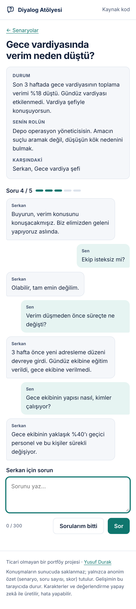

# Diyalog Atölyesi

Yöneticiler için **doğru soru sorma pratiği**. Bir senaryo seçersin; karşındaki karakter bildiğini ancak doğru soruya anlatır. 5 soru hakkın var. Sonunda kök nedeni tahmin edersin ve soruların tek tek değerlendirilir.

Ticari olmayan bir portföy projesidir. Arayüz Türkçedir.

| Oturum | Rapor |
|---|---|
|  |  |


**Projeyi anlatırken:** Mülakatta sorulabilecek 10 soru, kısa cevaplar ve verilen kararlar (sorun → karar → bedel): [docs/MULAKAT.md](docs/MULAKAT.md).

## Genel bir sohbet botundan farkı

- **Bilgi kazanılır.** Karakterin gizli bilgileri vardır ve her birinin bir açılma koşulu vardır. Evet/hayır sorusu kısa cevap alır, suçlayan soru savunma alır.
- **Her oturum aynı rubrikle puanlanır.** Beş boyut: açık uçlu soru, derinleşme, varsayımsız soru, bilgi keşfi, sonuç. Üçü kodla hesaplanır, ikisini model yazılı ölçütlere göre puanlar.
- **Ezber işe yaramaz.** Senaryoların farklı kök nedenleri (varyantları) var; tekrar oynayınca oynamadığın biri gelir. Öğrenilen şey cevap değil, soru kalıbı olur.
- **Gelişim görünür.** Her varyantın ilk denemesi grafiğe girer; tekrar oynanan senaryo skoru şişirmez.

## Yapı

```
senaryolar/*.json ─▶ çekirdek (src/cekirdek): oturum kuralları, karakter ve değerlendirici istemleri, puanlama
                        ├─ web kapısı  /api  ─▶ web/ (düz HTML, JS, CSS)
                        └─ MCP kapısı  /mcp  ─▶ Claude ve diğer MCP istemcileri
```

Kurallar tek yerdedir; iki kapı da aynı üç komutu çağırır: `baslat`, `soruSor`, `degerlendir`.

## Kendi bilgisayarında dene

Node.js 22.13 ya da üstü gerekir.

```bash
npm install
npm run start:dev      # yapay zekâsız deneme modu: http://localhost:8080
npm test               # 35 test
```

Gerçek modelle çalıştırmak için `.env.example` dosyasını `.env` olarak kopyala ve `ANTHROPIC_API_KEY` değerini yaz.

## Belgeler

- [Nasıl çalışır](docs/NASIL_CALISIR.md): mimari, puanlama, maliyet, gizlilik ve "sorulursa ne derim" notları
- [Sunucu kurulumu](docs/SUNUCU_KURULUMU.md): diyalog.ysfdurak.com adresinde yayın
- [MCP](docs/MCP.md): Claude'a bağlama
- [Senaryo yazma](docs/SENARYO_YAZMA.md): yeni senaryo ekleme

## Lisans

Bu proje [PolyForm Shield 1.0.0](LICENSE.md) lisansıyla yayınlanır. Kaynak kodu açıktır, ancak resmi anlamda bir "açık kaynak" lisansı değildir.

- **Serbest:** Kişiler, okullar ve şirketler kendi işlerinde ücretsiz kullanabilir, değiştirebilir ve kendi bilgisayarlarına ya da sunucularına kurabilir. İzin almak gerekmez.
- **Yazılı izin gerekir:** Yazılımı satmak, adını değiştirip ürün gibi sunmak ya da bununla (ücretsiz olsa bile) rakip bir ürün veya hizmet sunmak.
- **Garanti yok:** Yazılım olduğu gibi sunulur. Bağlayıcı olan İngilizce lisans metnidir.
- Üçüncü taraf bileşenler kendi lisanslarına tabidir.

Kurumunuzda kullanıyorsanız haber verirseniz sevinirim: kurulumda yardımcı olabilir, kurumunuza özel ihtiyaçları birlikte değerlendirebiliriz. İletişim: iletisim@ysfdurak.com

### License (English)

Released under [PolyForm Shield 1.0.0](LICENSE.md). The source is available, but this is not an OSI "open source" licence.

- **Free:** individuals, schools and companies may use it in their own work, change it and run it on their own computers or servers. No permission needed.
- **Needs written permission:** selling it, rebranding it as a product, or providing a product or service that competes with it (even free of charge).
- **No warranty:** provided as is. The English licence text is binding.
- Third-party components keep their own licences.

Using it in your organisation? I'd be glad to hear from you: I can help with setup and look at your organisation's needs together. Contact: contact@ysfdurak.com

