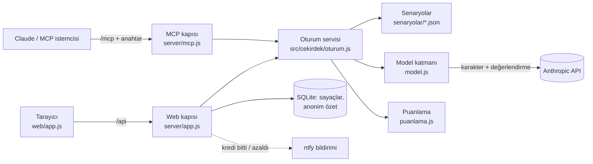

# Diyalog Atölyesi · Proje dokümanı

Yaşayan hâkimiyet rehberi. Amacı: kodu açmadan projeyi baştan sona anlatabilmen, bir mülakatta her kararı savunabilmen ve küçük bir değişikliği kendi elinle yapabilmen. Her geliştirme oturumunda güncellenir (en altta günlük).

Ayrıntı belgeleri: [Nasıl çalışır](NASIL_CALISIR.md) · [Senaryo yazma](SENARYO_YAZMA.md) · [Sunucu kurulumu](SUNUCU_KURULUMU.md) · [MCP](MCP.md) · [Mülakat kartı](MULAKAT.md)

---

## 1. Bir bakışta

| | |
|---|---|
| **Ne** | Yöneticiler için doğru soru sorma pratiği. Senaryo seç, karakterle konuş, 5 soruda kök nedeni bul; sorular tek tek puanlanır. |
| **Kimin için** | Yöneticiliğe hazırlanan ya da ekip yöneten kişiler (portföy projesi, ticari amaç yok) |
| **Canlı** | https://diyalog.ysfdurak.com (VPS, Docker, ortak Caddy) |
| **Depo** | https://github.com/ysfdurak/diyalog-atolyesi (herkese açık, PolyForm Shield lisansı) |
| **Durum** | Yayında. Soru modu: 45 senaryo, hepsi üç kök nedenli, 135 oturum (hedef bir yıl: ~122 senaryo, 365 oturum); ana sayfada alan filtresi. Zor konuşma modu henüz yok. |
| **Yapay zekâ** | Anthropic API (Haiku 5.5): karakter cevapları ve değerlendirme |
| **Maliyet** | Oturum başına yarım sentin altı (tahmin); günlük limitler ve kredi bildirimiyle sınırlı |

## 2. Sorun ve verdiğin kararlar

**Sorun:** Yöneticilikte hata çoğu zaman yanlış cevap değil, yanlış sorudur. Kapalı ("Ekip mi isteksiz?"), yönlendiren ya da suçlayan soru kök nedeni saklar. Genel bir sohbet botu bunu öğretmez: istediğin her şeyi hemen söyler ve ölçmez.

**Senin kararların** (mülakatın asıl konusu):

| Karar | Neden | Bedeli / bilerek dışarıda kalan |
|---|---|---|
| Karakter gizli bilgiyi yalnız doğru soruya açar | Beceriyi geliştiren şey bu zorluk | Karakterin ayarı (ne kadar kolay açtığı) gerçek modelle denenmeli |
| Her oturum aynı rubrikle puanlanır; puanın çoğu kodla hesaplanır | Oturumlar karşılaştırılabilsin, "yapay zekâ keyfine göre puanlıyor" denmesin | Model soruları yine de yanlış etiketleyebilir |
| Varyant sistemi: aynı durum, farklı kök neden | Rapor cevabı gösterdiği için tek kök nedenli senaryo bir kez oynanınca "yanıyordu" | Her varyant ayrı içerik emeği |
| Kapsam sınırı: 2 mod, ~10 senaryo; ses, video, hesap yok | Portföy projesi; işverene yeni bir şey göstermeyen emek israf | Ticari ürün özellikleri yok |
| Aday Atölyesi'ne modül değil, ayrı uygulama | Aday Atölyesi yapay zekâsız ve sıfır maliyetli; kitleleri farklı | İki uygulama arasında köprü bağlantısı gerekir |
| Konuşma metni kaydedilmez | Gizlilik; kaydedilecek bir şey yoksa sızacak bir şey de yok | Kullanıcı eski konuşmasını sunucudan geri alamaz |
| Kredi biterse kapan, bildir, kendiliğinden aç | Fatura sürprizi ve bozuk görünen site olmasın | "Kredi azaldı" bir tahmin |

Benchmark ve konumlandırma: Kovuldun (Türkçe, ikna odaklı, eğlence) ile Yoodli, Exec, Mursion (İngilizce, kurumsal) arasında Türkçe, soru sormayı ölçen bireysel bir boşluk.

## 3. Mimari ve veri akışı

**Bir oturumun yolu:**
1. Tarayıcı senaryoyu ve bu senaryoda daha önce oynadığı varyant kimliklerini gönderir.
2. Sunucu günlük limiti düşer, oynanmamış bir varyantı rastgele seçer, oturumu **bellekte** açar.
3. Her soru: karakter çağrısı → cevap + "bu cevapta açılan bilgi kimlikleri".
4. Tahmin: değerlendirici çağrısı → soru etiketleri + iki boyutun puanı → kod skoru hesaplar → rapor.
5. Sunucuya yalnız anonim özet yazılır (senaryo, varyant, soru sayısı, skor, süre). Gelişim kaydı tarayıcıda.

**İkili yapı:** Kurallar tek yerde (oturum servisi). Web ve MCP yalnız bu üç komutu çağırır: `baslat`, `soruSor`, `degerlendir`. Bir kural değişirse iki kapı da aynı anda değişir.

## 4. Teknoloji seçimleri

| Seçim | Neden | Elenen alternatif |
|---|---|---|
| Node.js, yerleşik `http` | Az bağımlılık, küçük konteyner | Express: bu boyutta gereksiz katman |
| Derleme adımsız düz JS arayüz | Tek dosya, hızlı açılış, kolay inceleme | React: üç ekran için ağır |
| SQLite (`node:sqlite`) | Yalnız sayaç ve özet tutuluyor; ek servis yok | Ortak PostgreSQL: bu iş için fazla |
| Anthropic "tool use" ile zorunlu biçim | Model serbest metin yazamaz, JSON ayrıştırma hatası olmaz | Serbest metinden düzenli ifadeyle okumak |
| Karakter ve değerlendirici ayrı model ayarı | Karakter hızlı/ucuz, değerlendirici gerekirse güçlü | Tek model: maliyet ya da kalite kaybı |
| Senaryolar JSON dosyası | Yeni senaryo kod değil içerik işi; alan bilgin doğrudan girer | Veritabanı ve yönetim paneli: gereksiz |
| ntfy bildirimleri | Hesapsız, telefona anında | E-posta: kurulumu ağır |

## 5. Kod turu

| Dosya | Ne yapar | Bilmen gereken |
|---|---|---|
| `src/cekirdek/senaryolar.js` | Senaryoları okur, doğrular, varyantları çözer | Hatalı senaryoyla sunucu **başlamaz**. Varyantsız eski dosya tek varyant (`v1`) sayılır. `herkeseAcik` gizli bilgiyi asla dışarı vermez. |
| `src/cekirdek/oturum.js` | Uygulamanın kalbi: oturum aç, soru sor, değerlendir | Soru hakkı, uzunluk sınırı, eşzamanlı istek kilidi, varyant seçimi burada. Model tanımsız bir bilgi kimliği dönerse yok sayılır. |
| `src/cekirdek/istemler.js` | Karaktere ve değerlendiriciye verilen talimatlar | Karakterin davranışını ayarlamak isteyince değişecek dosya burası. |
| `src/cekirdek/model.js` | Anthropic çağrısı ve sahte (kural tabanlı) model | Kredi/yetki/geçici hata ayrımı burada. Sahte model testler ve anahtarsız deneme için; `ipucu_kelimeler` yalnız onu ilgilendirir. |
| `src/cekirdek/puanlama.js` | Beş boyut, ağırlıklar, 100'lük skor | Modelden bozuk çıktı gelirse güvenli varsayılanlara çeker. |
| `src/cekirdek/uzman.js` | Model puanlarını uzman puanlarıyla karşılaştırır (kappa) | `degerlendirme/` klasöründeki taslak setle çalışır. |
| `server/app.js` | HTTP, limitler, kredi durumu, güvenlik başlıkları | Kredi bitince kapanma ve 30 dakikada bir yeniden deneme burada. |
| `server/gercek-ip.js` | Ziyaretçinin gerçek IP'si | Başlığa yalnız güvenilen vekilden (Caddy, Cloudflare) gelirse güvenir; Cloudflare adres listesi elle güncellenir. |
| `server/mcp.js` | Aynı komutları MCP araçları olarak sunar | Kural içermez; anahtarsız açılmaz. |
| `server/store.js` | SQLite: sayaçlar, anonim özet, kullanım | Eski veritabanına yeni sütunu kendisi ekler. |
| `web/app.js` | Üç ekran: ana sayfa, oturum, rapor | Metinler `textContent` ile yazılır (`innerHTML` yok). "Bu soruyu yeniden dene" de burada. |

**Bir varyantın yolu (örnek):** `depo-verim-dususu.json` içinde `varyantlar[2]` → `varyantCozumle` onu açılış ve karakterle birleştirir → oturum bu birleşik nesneyle çalışır → istem ve puanlama farkı bilmez. Yani varyant sistemi çekirdeğin geri kalanını değiştirmedi; bu, iyi bir tasarım sınırı örneği.

## 6. Sunucu ve yayın

Ortak altyapı (VPS, Docker, ortak Caddy, Cloudflare) site deposunda anlatılır. Bu projeye özgü olanlar:

- Kurulum ve güncelleme tek komut: `bash ~/ysfdurak.com/sunucu/kurulum-diyalog.sh`. Ayrıntı: [SUNUCU_KURULUMU.md](SUNUCU_KURULUMU.md)
- Konteyner sertleştirilmiş: salt okunur kök, yetkiler kapalı, bellek ve süreç sınırı, dışarıya port açılmaz (`deploy/docker-compose.ortak.yml`).
- Ayarlar `~/diyalog-atolyesi/.env`: API anahtarı, limitler, `BILDIRIM_URL`, `KREDI_USD`.
- Kullanım ve tahmini maliyet: `sudo docker exec diyalog node server/istatistik.js`
- Ölçüm: yalnız resmî adreste `olcum.ysfdurak.com` betiği yüklenir; kendi kurulumlar dışarıya istek atmaz.

## 7. Testler

- **Otomatik:** `npm test` (35 test, yapay zekâ çağrısı yok) ve tarayıcı duman testi. İkisi de her pull request'te GitHub Actions'ta çalışır.
- **Her varyant testi:** Her senaryonun her kök nedeninde, sahte modelle ideal sorular en az iki kritik bilgiyi açmalı ve suçlayıcı ilk soru "yönlendirici" sayılmalı. Yeni senaryo eklerken en çok bu test yakalar.
- **Uzman karşılaştırması:** `degerlendirme/son-karsilastirma.md`. Set **taslak** (etiketleri Claude hazırladı) ve yalnız ilk altı senaryodan.

**Son örneklem testi (24 Kasım 2026, yeni senaryolar, sahte model):**

| Adım | Beklenen | Gözlenen | Durum |
|---|---|---|---|
| Ana sayfa | 10 kart, yeni alan etiketi | 10 kart, "Proje yönetimi" etiketi | Geçti |
| Yeni kart | "3 farklı kök neden" yazısı | Görünüyor | Geçti |
| "Selin terfiyi neden reddetti?" iki açık soru | Karakter ilgili bilgiyi açar | İki kritik bilgi açıldı | Geçti |
| Rapor | Kök neden bilgisi, tekrar önerisi | "2. kök nedenle karşılaştın" | Geçti |
| Konsol | Hata yok | Hata yok | Geçti |
| Canlı adres (`/api/durum`) | Depo senaryosu 3 varyantlı | v1, v2, v3 görünüyor; yapay zekâ açık | Geçti |
| Yeni senaryolar gerçek modelle | Karakter bilgiyi ne çok kolay ne çok zor açar | **Henüz denenmedi** | [doğrulanacak] |

## 8. Bilinen sınırlar ve sonraki adımlar

- **Gerçek model ayarı yapılmadı.** Senaryolar ve varyantlar yalnız sahte modelle doğrulandı. Önce bu.
- **İçerik hedefi bir yıl:** ~122 senaryo × 3 kök neden ≈ 365 oturum; partiler hâlinde ilerliyor. Konuların yarısı kullanıcının kendi işinde yaşadığı sorunlardan. 90 kök nedenin hiçbiri gerçek modelle oynanmadı; gerçekçilik incelemesi kullanıcıda.
- **Uzman seti taslak** ve yeni senaryoları kapsamıyor; bir eğitmen ya da İK uzmanı onaylamalı.
- Metin tabanlı; ses tonu ve beden dili yok. Hesap yok; gelişim başka cihaza taşınmaz.
- Sunucu yeniden başlarsa yarım oturumlar kaybolur.
- Sonraki büyük adım: zor konuşma modu (geri bildirim, görev devri, çatışma, davranışsal liderlik), o da varyantlı. Ardından vaka sayfası ve Aday Atölyesi köprüsü.

## 9. Mülakat soruları

Ayrıntılı kart: [MULAKAT.md](MULAKAT.md). Bu oturumdan eklenenler:

**"Aynı senaryoyu tekrar oynayınca cevabı bilmiyor musun?"**
Senaryoların farklı kök nedenleri var; tekrar oynayınca oynamadığın biri geliyor. Önceki raporu hatırlamak işe yaramıyor, işe yarayan "ne değişti, iş nerede takılıyor, bunu nasıl ölçüyoruz" gibi soru kalıpları. Asıl öğretmek istediğim de bu.

**"Varyantı nasıl seçiyorsun, kullanıcıyı nasıl tanıyorsun?"**
Hesap yok. Tarayıcı, oynadığı varyantların kimliklerini (v1, v2…) gönderiyor; sunucu oynanmamışlardan rastgele seçiyor. Kimlikler içerik taşımadığı için oyun sırasında hangi kök nedenin geldiği anlaşılmıyor.

**"Neden 'Proje yönetimi' diye yeni bir alan?"**
Soru sorma becerisi yalnız operasyona özgü değil. Proje gecikmesinde de aynı kalıplar ("ne değişti, en çok ne bekletiyor") farklı kök nedenlere (kapsam, tek anahtar kullanıcı, dış tedarikçi) götürüyor.

## 10. Kendini test et

Senaryo dosyasında gizli bilgi en üstte de varyantların içinde de varsa ne olur?

Sunucu başlamaz; doğrulama "varyantlar kullanılırken gizli bilgiler her varyantın içinde olmalı" der. Belirsizlik yayına çıkmasın diye bilerek böyle.

Toplam skoru kim hesaplıyor: model mi, kod mu?

Kod. Model soruları etiketler (açık/kapalı, yönlendirici) ve iki boyutu puanlar; açık uçluluk, varsayımsızlık ve bilgi keşfi oranlardan, toplam ağırlıklarla kodda hesaplanır.

Kredi biterse ziyaretçi ne görür, sen ne alırsın?

Ziyaretçi "canlı oturumlar geçici olarak kapalı" mesajını görür, hakkı düşmez, örnek oturum açık kalır. Sana acil ntfy bildirimi gelir. Kredi yüklenince 30 dakika içinde kendiliğinden açılır.

Sahte model gerçek modelden neyle ayrılır?

Sahte model `ipucu_kelimeler` listesine bakar; gerçek model `acilma_kosulu` cümlesini yorumlar. Bu yüzden sahte modelle geçen bir senaryo gerçek modelde farklı davranabilir.

Gelişim grafiği neden yalnız ilk denemeyi sayar?

Aynı kök nedeni ikinci kez bulmak beceri değil hatırlamadır; sayılırsa skor şişer.

## 11. Elle yapılacak alıştırma

**Değişiklik (10 dakika):** "Selin terfiyi neden reddetti?" senaryosunda soru hakkını 5'ten 4'e indir ve farkı gör.
1. `senaryolar/terfi-reddi.json` dosyasında `"soru_hakki": 5` satırını `4` yap.
2. `npm test` çalıştır. Hangi test neden kırıldı? (İpucu: her varyant testi ilk soru + 4 ideal soru soruyor; 5 soru hakkı gerekiyor.)
3. Testin neyi koruduğunu anladıktan sonra değeri 5'e geri al.

**5 dakikalık demo akışı:**
1. Sorun (30 sn): "Yöneticilikte hata çoğu zaman yanlış sorudur."
2. Canlı oturum (2 dk): Depo senaryosunda önce kötü bir soru ("Ekip mi isteksiz?"), sonra iyi bir soru ("Verim düşmeden önce ne değişti?"). Farkı göster.
3. Rapor (1 dk): beş boyut, kaçırılan bilgiler, "Bu soruyu yeniden dene".
4. Tasarım kararı (1 dk): varyant sistemi ve puanın kodla hesaplanması.
5. Sınırlar (30 sn): gerçek model ayarı ve uzman onayı bekleyen değerlendirme.

## 12. Değişiklik günlüğü

| Tarih | Değişiklik |
|---|---|
| 2026-11-24 | Hedef bir yıllık içerik olarak büyütüldü. Yeni alanlar: Veri ve raporlama (8), Tedarik ve satın alma (7): 45 senaryo, 135 oturum. Senaryo üretici kütüphanesi karakter adlarının tekrarını da engelliyor; testler senaryo sayısını dosyalardan okuyor. |
| 2026-11-24 | Son 15 senaryo (fazla mesai bütçesi, depo birleştirme, pilot yaygınlaştırma, mal kabul, denetim bulguları, rampa bekleme, ramak kala, eğitim, personel desteği, usta, vardiya gerginliği, elle rapor, kullanılmayan sistem, proje bütçesi, yeşil rapor) ve ana sayfada alan filtresi: 30 senaryo, 90 oturum. Senaryolar denetimli bir üretici betikle yazıldı (her ideal sorunun sahte modelde doğru bilgiyi açtığı yazarken kontrol edildi). |
| 2026-11-24 | Gerçek sorunlardan beş senaryo (yatırım önerisi, BT talepleri, tekrar eden destek çağrıları, her kararın yöneticiye gelmesi, kalıcı olmayan iyileştirme): 15 senaryo, 45 oturum. |
| 2026-11-24 | Eski beş senaryoya ikişer kök neden eklendi: 10 senaryo, 30 oturum. Hedef 30 senaryo, 90 oturum olarak belirlendi. Eski biçim testi geçici dosyaya taşındı. |
| 2026-11-24 | Dört yeni senaryo, her biri üç kök nedenli (sayım farkları, yeni hizmet paketi, terfi reddi, proje gecikmesi); yeni alan: Proje yönetimi. 10 senaryo, 20 oturum. Bu proje dokümanı oluşturuldu. |
| 2026-11-20 | Ortak ölçüm ve geri bildirim (yalnız resmî adreste); geniş ekranda iki sütun kart; CI sürüm güncellemeleri |
| 2026-11-19 | Konteyner sertleştirme; sahte IP başlığına karşı güvenilen vekil kuralı; gizlilik sayfası; puanın dayanağı ve uzman karşılaştırma aracı; tarayıcı duman testi; mülakat kartı |
| 2026-11-18 | "Bu soruyu yeniden dene"; testler her PR'da otomatik |
| 2026-11-17 | Varyant sistemi; üç yeni senaryo; PolyForm Shield lisansı; canlı yayın |
| 2026-11-16 | Kredi biterse kapanma ve ntfy bildirimi; tek komutla sunucu kurulumu |
| 2026-11-15 | V1: soru modu, 3 senaryo, web + MCP |
